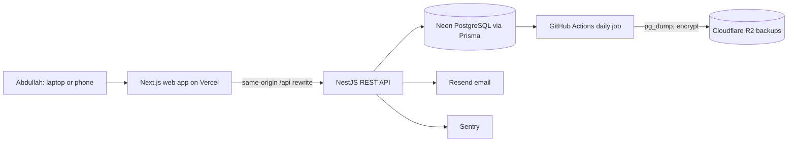
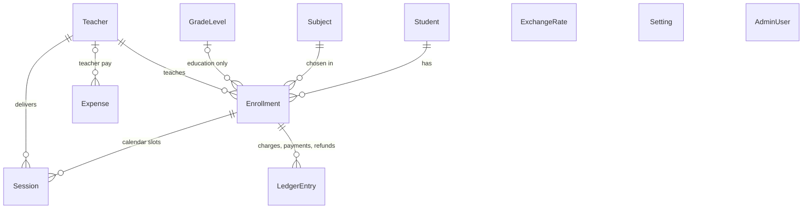

# Project Spec: Music & Education Center Management System

**Version:** 1.0 (draft for team approval)  **Date:** 4 Nov 2026
**Client:** Abdullah Maatouk  **Team Lead:** Majd Maatouk
**Team:** Majd Maatouk, Mirna Derbieh (design and engineering), Ali Othman (DevOps)
**Related documents:** `PRD_Center_Management_System.md`, `Project_Plan_Center_Management_System.md`, `schema_v5.prisma` (v6 changes listed in section 2.5)

This spec says **what we are building and how we are building it**. The PRD holds the requirement list and acceptance criteria. This document explains the purpose, the rules, and the technical design behind them.

---

# Part 1: Product Requirements

## 1.1 Product Purpose

A private web application for one person, the center owner, to run a music and education center from one place: register students, enroll them, schedule lessons, record payments, see who owes money, track expenses, and see profit. It replaces notebooks and Excel from day one. The center launches with no old records, so the system is the single source of truth from its first day.

**Success looks like:** Abdullah does all registration, payments, scheduling, and expense tracking in the site, the dashboard matches his own calculations, and weekly backups arrive. The biggest failure is losing payment records.

## 1.2 Who is the product for?

| | |
| --- | --- |
| **Primary user** | Abdullah Maatouk, the owner and admin. The only user in v1 |
| **Comfort level** | Comfortable with software, works in both Arabic and English |
| **Devices** | Mostly laptop. Phone for urgent tasks |
| **Scale (year 1)** | 50 to 70 students, 5 to 10 teachers, a few dozen subjects |
| **Not users** | Teachers, students, and parents do not log in. Nothing is sent to them |
| **Later** | More users with limited roles (for example an assistant) are possible in a later version |

## 1.3 What problems does it solve?

In order of importance, as set by the client:

1. **"Who owes me money?"** Every student's balance is calculated from charges and payments, so nothing is forgotten or guessed.
2. **Lesson schedule clashes.** One calendar shows every lesson and warns on teacher overlaps.
3. **Wrong profit numbers.** Revenue (money received) and all expenses live in one place, with both currencies handled by saved exchange rates.
4. **Losing records.** The data lives in a hosted database with automatic daily backups, weekly Excel exports, and a tested restore.

## 1.4 What does the product do?

### Functionality

| Module | What it does |
| --- | --- |
| **Students** | Register, search, edit, archive. Name, birth date (or age), phone, parent name and phone, school, notes. Profile shows enrollments, remaining music sessions, balance, and payment history |
| **Teachers** | Name, phone, pay notes, active status |
| **Subjects and prices** | One list of instruments and school subjects (agenda included). Each has a type (Music or Education), a monthly group price and a one-on-one price in USD, a default lesson length per format, and for music a default number of sessions per month |
| **Grade levels** | Grades with a price rate (Grade 3 = 1.2) |
| **Enrollments** | A student joins one subject as Music or Education, with teacher, group or one-on-one, start date, optional discount. The monthly price is calculated and saved. A student can have several enrollments |
| **Calendar** | Day and week views. Assign a student to a slot with a teacher, date, and time. Lessons can repeat weekly. Group lessons are several students in one slot. Warnings for teacher overlaps and exhausted music sessions |
| **Monthly charges** | A button creates the month's charges for active enrollments as a review list. The admin edits or skips, then confirms |
| **Payments** | Record full or partial payments with method (cash, transfer, Whish/OMT, card, other), currency (USD or LBP), and date. Refunds are separate entries |
| **Balance** | Calculated per enrollment and per student. Credit balances are allowed |
| **Exchange rate** | The USD to LBP rate, updated manually |
| **Expenses** | Rent, utilities, teacher pay, equipment, marketing, other, in USD or LBP |
| **Dashboard** | Revenue, expenses, profit, outstanding balances, revenue per subject and per teacher, active students. Period filter and USD/LBP switch |
| **Reminders** | In-app panel: students with outstanding balances, music students low on sessions |
| **Receipts** | Downloadable PDF per payment, in Arabic or English |
| **Backup** | One-click Excel export of all data, a weekly reminder and notification email, and automatic database backups |
| **Settings** | Center name, open days and hours for the calendar, defaults |
| **Language** | Arabic (RTL) and English, switchable at any time |

### Jobs to be done

| # | When... | I want to... | So that... |
| --- | --- | --- | --- |
| 1 | A new student arrives at the center | Register them and enroll them in a subject with the right format and discount in one flow | They are set up and I see the price immediately |
| 2 | A parent pays | Record the payment (full or deposit, method, currency) in under 30 seconds, even on my phone | The balance is correct and I can hand over a receipt |
| 3 | A parent asks what they owe | Search the student and see the balance | I can answer on the spot |
| 4 | A student is enrolled | Put them in an open slot on the calendar, repeating weekly | Their lessons are booked without clashes |
| 5 | A new month starts | Generate the month's charges, adjust the ones that differ, and confirm | Everyone is billed correctly |
| 6 | A music student has used their sessions | See a warning before assigning another | I decide knowingly, with override |
| 7 | I make a mistake | Void the wrong entry | History stays honest and totals fix themselves |
| 8 | I spend money on the center | Record the expense with its category | Profit is accurate |
| 9 | I want to know how the center is doing | Open the dashboard and choose a period and currency | I see revenue, expenses, and profit without calculating |
| 10 | I worry about losing data | Download an Excel export and know automatic backups exist | I can always recover |

## 1.5 Business Rules

**Pricing (monthly, USD)**

| Case | Monthly price |
| --- | --- |
| Music | Instrument price for the chosen format (group or one-on-one) |
| Education (school subject or agenda) | Subject price for the chosen format × grade rate |
| Discount | Optional percentage or fixed amount on the enrollment, applied every month until changed |

Example: Math, group, 20 USD, Grade 3 (rate 1.2) → **24 USD**. The result is saved on the enrollment, so later price changes never affect existing students.

**Enrollments and charges**

- Every enrollment is a one-month plan that renews. There is no per-session billing.
- A student who joins mid-month pays the full month. The discount can adjust it.
- A paused enrollment is not charged. An ended enrollment stops charges from the next month.
- A student taking two subjects has two enrollments, each with its own price and balance.
- Charges are created only when the admin presses the button and confirms the review list. The same enrollment cannot be charged twice for one month.

**Music sessions**

- Each music enrollment has sessions per month, copied from the instrument and editable per student.
- A session is used when the student is assigned to a calendar slot, whether or not they attend.
- Remaining = allowance − sessions in that calendar month (Beirut time). The count resets monthly with no carry-over. Education has no limit.
- Deleting a slot returns the session. Moving a slot keeps the count.
- Exceeding the limit warns but can be overridden.

**Money**

- Prices are in USD. Payments and expenses can be in USD or LBP, each saving the exchange rate used and the USD value.
- **Balance** = charges − payments + refunds, ignoring voided entries. A negative balance is a credit.
- **Revenue** = payments received − refunds, by payment date. **Profit** = revenue − expenses.
- Mistakes are voided, never deleted. A refund is a real event on its own date, not a void.
- Changing the exchange rate never changes past records.

## 1.6 Out of Scope (v1)

Public website, accounts for teachers, parents, or students, online payments, messages to parents, per-session billing, installment schedules, rooms, attendance and make-up tracking, recurring expenses, automatic teacher pay, video lessons, and extra user roles. See the PRD stretch goals for the next-version list.

---

# Part 2: Engineering Design

## 2.1 Tech Stack

| Layer | Choice | Notes |
| --- | --- | --- |
| Language | TypeScript everywhere | Strict mode. Money and dates reward strict types |
| Frontend | Next.js (App Router), Tailwind CSS, shadcn/ui | RTL through logical Tailwind utilities and `dir` |
| Backend | NestJS, REST API | Modules per domain, class-validator or Zod for input |
| Database | PostgreSQL on Neon (free), Prisma 6 | Pooled connection at runtime, direct connection for migrations |
| Authentication | Built in-house in NestJS (no Clerk) | Password, TOTP 2FA, recovery codes, 30-minute idle timeout |
| Email | Resend | Notifications only, to the admin |
| Hosting | Vercel (see risk 2.9) | Next.js app and API deployed from the same repo |
| Backup storage | Cloudflare R2 (free tier) | Encrypted daily database dumps |
| Source control and CI | GitHub, GitHub Actions | Also runs the daily backup job |
| Repo layout | pnpm workspaces: `apps/web`, `apps/api`, `packages/shared` | Shared types and Zod schemas |
| i18n | next-intl | Arabic and English dictionaries |
| Forms and data | React Hook Form + Zod, TanStack Query, TanStack Table | |
| Calendar | FullCalendar (open-source core) | Day and week time grids, RTL |
| Charts | shadcn charts (Recharts) | |
| Excel | ExcelJS | |
| PDF receipts | `@react-pdf/renderer` or pdfmake with an Arabic font | Day-1 Arabic test. Fallback: HTML receipt printed to PDF |
| Dates and time zone | `date-fns` + `date-fns-tz` (Asia/Beirut) | |
| Money | Prisma `Decimal` and `decimal.js` | Never floats |
| Testing | Jest (API), Vitest (shared and web), Playwright (a few end-to-end flows) | |
| Monitoring | Sentry free tier, free uptime checker | Ali confirms current limits |

## 2.2 Engineering Requirements

**Security**
- HTTPS only, security headers, and a basic content security policy.
- Passwords hashed with argon2id. Login rate limiting and temporary lockout after repeated failures.
- TOTP two-factor authentication is mandatory. 10 recovery codes, stored hashed. The TOTP secret is encrypted at rest.
- Session expires after 30 minutes of inactivity.
- No public sign-up. The admin account is created by a seed script. A forgotten password is reset by Ali with a documented script.
- All input validated on the server. Prisma queries are parameterized.
- Secrets live in environment variables (Vercel and GitHub secrets), never in the repo. No personal data in logs.

**Reliability and data safety**
- Daily automatic backup, recovery within one day (RPO 24 hours, RTO 1 day). Neon's built-in restore window (about 6 hours on the free plan) is an extra layer, not the plan.
- Weekly Excel export, with an in-app reminder if none was made in 7 days.
- One full restore test before launch, then repeated regularly.
- Online only. Excel export is the emergency fallback.

**Performance and usability**
- Pages interactive in under 2 seconds on a normal connection once the database is awake. The first request after idle may be slower on the free tiers.
- Search, payment entry, and balance lookup are the fastest paths, designed for mobile.
- Works on the latest Chrome, Safari, Edge, Firefox, and on mobile Safari and Chrome.
- Every screen works in Arabic (RTL) and English.

**Quality**
- Unit tests for price calculation, discounts, balance, session counting, and currency conversion.
- Pull requests need passing checks and one teammate's approval. With the author, that makes 2 of 3 team members approving.
- A feature is done when it passes the Definition of Done in the project plan.

## 2.3 Architecture

- **Same-origin API.** Next.js rewrites `/api/*` to the NestJS API, so the session cookie is first-party and CORS stays minimal.
- **Cookie sessions.** A short-lived signed token in an `HttpOnly`, `Secure`, `SameSite=Lax` cookie, renewed on activity to give the 30-minute idle timeout.
- **Stateless API.** All state is in Postgres.
- **Portable by design.** No Vercel-only features, so the same code can move to another host.

## 2.4 System Design

### Data model (11 tables)

| Table | Purpose |
| --- | --- |
| Student | The person |
| Teacher | Teachers, with pay notes |
| Subject | Instruments and school subjects, with group and one-on-one prices, lesson lengths, default monthly sessions |
| GradeLevel | Grade name and price rate |
| Enrollment | One student, one subject, with type, teacher, format, saved price, discount, status |
| Session | One student in one calendar slot. Repeating lessons share a group id |
| LedgerEntry | Every charge, payment, and refund, with void date |
| Expense | Costs for profit |
| ExchangeRate | Manual USD to LBP rates |
| Setting | Open days and hours, defaults |
| AdminUser | Login, encrypted TOTP secret, recovery code hashes |

### Calculations (always computed, never stored)

- **Balance** = sum of non-void charges − non-void payments + non-void refunds, per enrollment and per student.
- **Remaining music sessions** = monthly allowance − `Session` rows in the Beirut calendar month.
- **Overdue** = an unpaid balance after its charge month.
- **Revenue and profit** as defined in section 1.5.

### Key flows

**Enroll a student**
1. Choose Music or Education. 2. Pick subject, format, teacher (and grade for Education). 3. The API calculates the price from the Subject and GradeLevel and returns it for display. 4. Admin adds an optional discount and saves. 5. The price is stored on the enrollment.

**Monthly charges**
1. Admin presses the button for a month. 2. The API returns a proposed charge for each active enrollment that does not already have one. 3. Admin edits amounts or skips some. 4. Admin confirms and the API creates the entries in one transaction. 5. A unique constraint blocks duplicates.

**Record a payment**
1. Choose the enrollment, amount, currency, method, date. 2. For LBP, the API uses the rate in effect and stores the rate and USD value. 3. A receipt number is assigned. 4. The balance updates because it is calculated.

**Assign a calendar slot**
1. Pick the student, teacher, date, time, length (defaulted from the subject), and optional repeat end date. 2. The API checks teacher overlaps and remaining sessions. 3. Warnings are returned and the admin can override. 4. Session rows are created in one transaction.

### REST API outline

| Resource | Main endpoints |
| --- | --- |
| Auth | `POST /auth/login`, `POST /auth/2fa/verify`, `POST /auth/logout`, `POST /auth/2fa/setup`, `POST /auth/recovery` |
| Students | `GET /students?search=`, `POST`, `GET /:id`, `PATCH /:id`, `POST /:id/archive`, `GET /:id/balance` |
| Teachers, Subjects, Grade levels | `GET`, `POST`, `PATCH /:id` |
| Enrollments | `GET`, `POST`, `PATCH /:id`, `POST /price-preview` |
| Sessions | `GET /sessions?from=&to=`, `POST` (with repeat), `PATCH /:id?scope=one\|following`, `DELETE /:id?scope=one\|following` |
| Charges | `GET /charges/proposal?month=`, `POST /charges/confirm` |
| Ledger | `POST /payments`, `POST /refunds`, `POST /ledger/:id/void`, `GET /ledger?enrollmentId=` |
| Receipts | `GET /payments/:id/receipt.pdf` |
| Expenses | `GET`, `POST`, `PATCH`, `POST /:id/void` |
| Exchange rates | `GET`, `POST` |
| Dashboard | `GET /dashboard?from=&to=&currency=` |
| Reminders | `GET /reminders` |
| Export | `GET /export/excel` |
| Settings | `GET`, `PATCH` |
| Health | `GET /health` |

### Environments and delivery

| Environment | Database | Deployment |
| --- | --- | --- |
| Local | Neon `dev` branch | Developer machine |
| Staging | Neon `staging` branch | Preview deployment per pull request |
| Production | Neon `main` branch | Deployed from `main` after checks |

- **CI (GitHub Actions):** lint, type check, unit tests, build on every pull request.
- **Migrations:** run by the pipeline before production deploys, with a backup taken first.
- **Release:** merge to `main` requires one teammate approval plus passing checks.

### Scheduled jobs

| Job | How | When |
| --- | --- | --- |
| Database backup | GitHub Actions: `pg_dump`, encrypt, upload to R2. Keep 30 daily and 12 weekly | Daily |
| "Export due" check and email | In the app, notification email through Resend | Weekly |

Everything else runs inside the app.

### Internationalization

- All text uses translation keys. Layout uses logical CSS properties (`ms-`, `me-`, `ps-`, `pe-`). The `dir` attribute follows the language.
- Numbers, dates, and currency are formatted per language. Receipts are bilingual.

## 2.5 Changes to schema v5 (becoming v6)

1. `LedgerType` gains `REFUND`.
2. `Subject` gains `groupMinutes` and `oneOnOneMinutes` (default lesson lengths).
3. `Session` gains `repeatGroupId` (optional string).
4. New `Setting` table (key and value) for open days, hours, and defaults.
5. `Student` keeps an optional `birthDate`. Entering only an age saves an approximate date.
6. `AdminUser` stays, with an encrypted TOTP secret and recovery code hashes.

## 2.6 Risks and Mitigations

| Risk | Mitigation |
| --- | --- |
| Development effort at capacity for two developers | Build in priority order, flag slips by day 5, use buffer days, Ali supports QA |
| Own authentication adds about 6 hours of work | Planned in the updated project plan. Use proven libraries, no custom cryptography |
| Free-tier cold starts (database and functions) | Health check pings, retry on first connection, design screens for a slow first load |
| Arabic text in PDFs | Day-1 test of the chosen library with the chosen font, with a print-to-PDF fallback |
| Month and time-zone mistakes in session counts | Calculate in Asia/Beirut, unit-test month boundaries |
| Balance and currency errors | Unit tests and a manual cross-check against a spreadsheet before launch |
| Backups not restorable | Restore test before launch and regularly after |
| 2FA lockout of the only admin | Recovery codes and Ali's documented reset script |

## 2.7 Hosting Risk (accepted by the client)

Vercel's free Hobby plan is for non-commercial use and allows one team member, so running a business on it is outside its terms and could lead to suspension. The client has chosen to proceed on the free plan.

- Keep the app portable and keep backups outside Vercel (R2).
- Ali verifies early that NestJS deploys and runs on Vercel, and how a three-person team deploys on a one-member plan.
- **Triggers to move:** a warning or suspension from Vercel, hitting a free-tier limit, or the center starting to depend on the system daily. Then upgrade to Pro or change host.

## 2.8 Decisions Log

| Decision | Choice |
| --- | --- |
| Authentication | Built in-house, no Clerk |
| Backups | Daily encrypted dumps to Cloudflare R2, plus weekly Excel export |
| Emails | Notifications only. The Resend account is registered with Abdullah's email until a domain exists |
| Charges | Created from a review list after pressing a button |
| Repeating lessons | Weekly until an end date, default end of the month, maximum 3 months. Edit one or all following |
| Refunds | Separate `REFUND` entries, not voids |
| Repo | One repo, Next.js and NestJS, pnpm workspaces |
| Release approval | Pull request with one teammate approval (2 of 3 with the author) |
| Team Lead | Majd Maatouk |

## 2.9 Open Items

- Ali: confirm Vercel Hobby deployment for NestJS and for three contributors; confirm Sentry and uptime-monitor free limits; choose the encryption tool and key storage for backups.
- Mirna: Arabic PDF test (library and font) on day 1; FullCalendar RTL check.
- Team: default lesson lengths per subject and default open hours (these are data entered in Settings, not code).
- Product Manager role is still unassigned.
- Center name, logo, and colors are placeholders until the client provides them.
- Update `Project_Plan_Center_Management_System.md` for own authentication, the new stack, and the v6 schema changes.